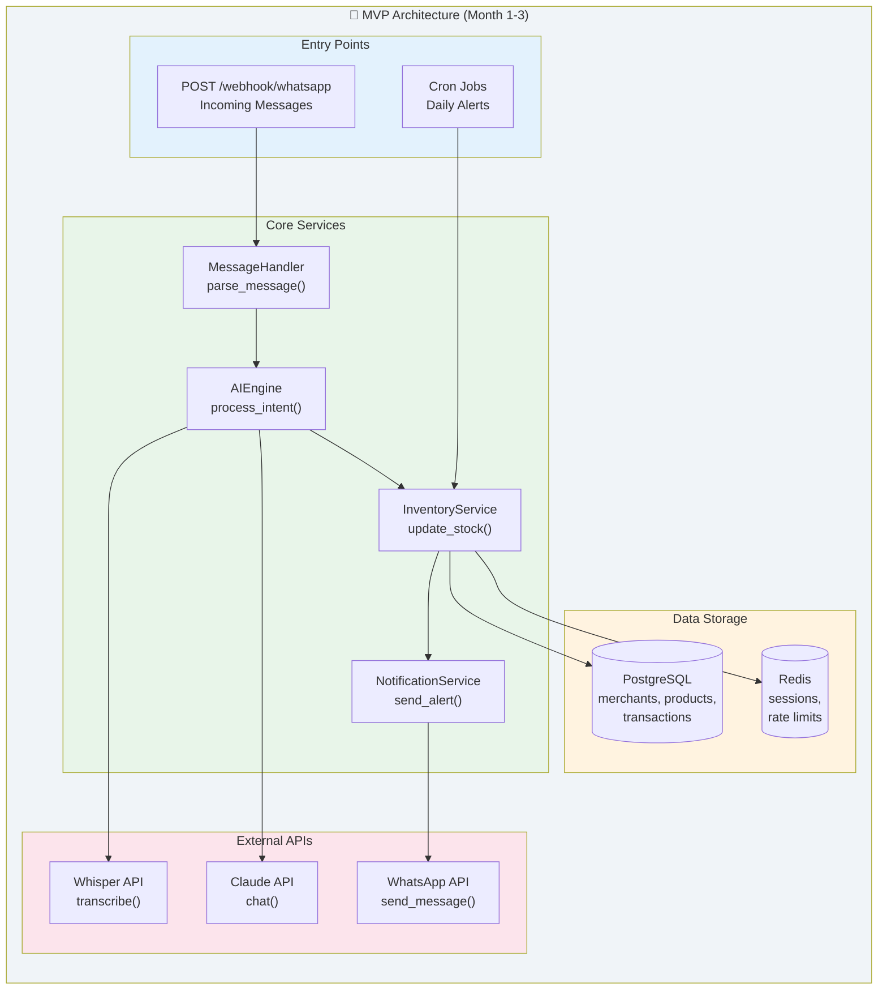
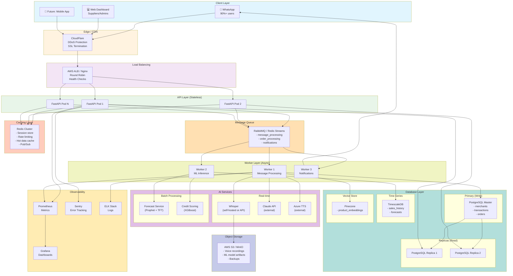
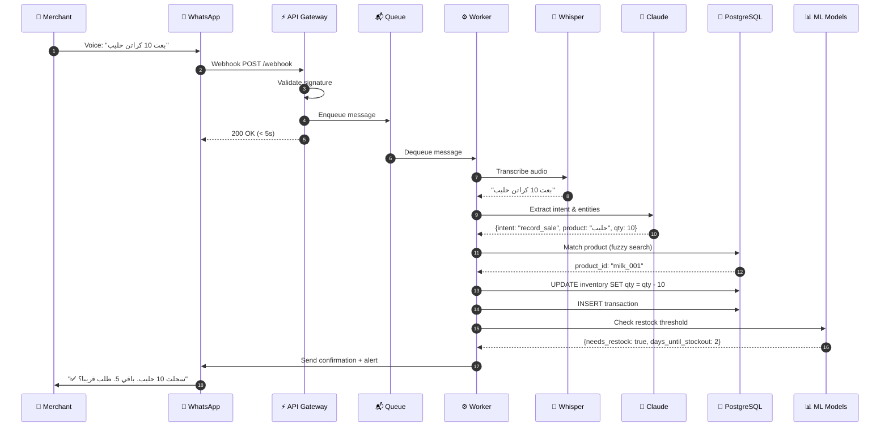
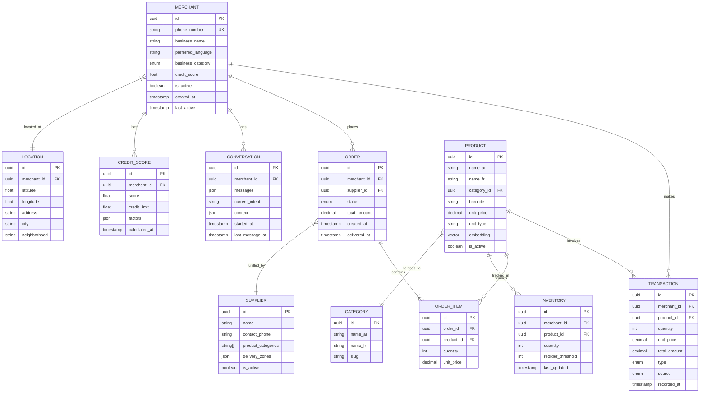
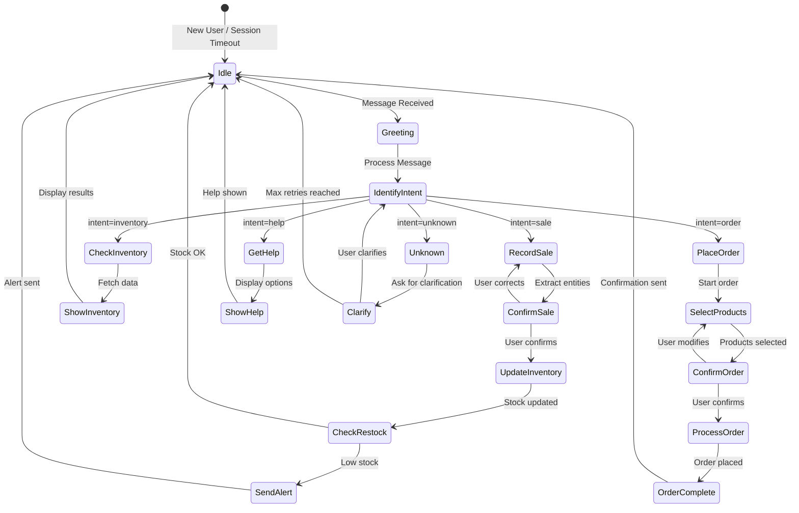
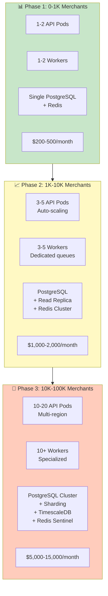
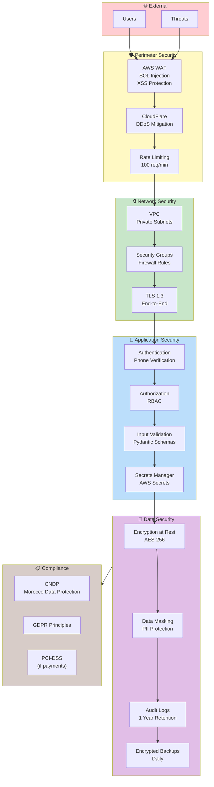

# 🏗️ Architecture Documentation

## 📋 Table des Matières

- [Architecture MVP](#architecture-mvp)
- [Architecture Complète](#architecture-complète)
- [Flux de Traitement des Messages](#flux-de-traitement-des-messages)
- [Modèle de Données](#modèle-de-données)
- [Pipeline CI/CD](#pipeline-cicd)
- [Machine d'État Conversationnelle](#machine-détat-conversationnelle)
- [Stratégie de Scalabilité](#stratégie-de-scalabilité)
- [Architecture de Sécurité](#architecture-de-sécurité)

---

## 🚀 Architecture MVP

Cette architecture représente la phase initiale du projet (Mois 1-3), conçue pour un déploiement rapide et efficace.

### Composants Principaux

- **Entry Points** : Points d'entrée pour les messages WhatsApp et les tâches planifiées
- **Core Services** : Services métier essentiels pour le traitement des messages et la gestion de l'inventaire
- **Data Storage** : Base de données PostgreSQL et cache Redis
- **External APIs** : Intégrations avec Whisper, Claude et WhatsApp

---

## 🏛️ Architecture Complète

Architecture de production scalable et hautement disponible.

### Couches d'Architecture

1. **Client Layer** : Interfaces utilisateur (WhatsApp, Web, Mobile)
2. **Edge/CDN** : Protection DDoS et terminaison SSL via CloudFlare
3. **Load Balancing** : Répartition de charge avec AWS ALB
4. **API Layer** : Pods FastAPI sans état pour haute disponibilité
5. **Message Queue** : File d'attente asynchrone avec RabbitMQ
6. **Workers** : Traitement asynchrone spécialisé
7. **AI Services** : Services d'IA en temps réel et batch
8. **Caching** : Cluster Redis pour performance
9. **Database** : PostgreSQL avec réplicas et TimescaleDB
10. **Monitoring** : Observabilité complète avec Prometheus, Grafana, Sentry et ELK

---

## 🔄 Flux de Traitement des Messages

Séquence détaillée du traitement d'un message vocal en arabe dialectal.

### Étapes du Flux

1. Le commerçant envoie un message vocal
2. Réception du webhook WhatsApp
3. Validation de la signature
4. Mise en file d'attente du message
5. Réponse rapide à WhatsApp (< 5s)
6. Traitement asynchrone du message
7. Transcription audio avec Whisper
8. Extraction de l'intention et des entités avec Claude
9. Correspondance du produit dans la base de données
10. Mise à jour de l'inventaire
11. Vérification du seuil de réapprovisionnement
12. Envoi de confirmation et alerte si nécessaire

---

## 💾 Modèle de Données

Schéma entité-relation de la base de données.

### Entités Principales

- **MERCHANT** : Informations des commerçants
- **PRODUCT** : Catalogue de produits bilingue
- **INVENTORY** : Gestion des stocks par commerçant
- **TRANSACTION** : Historique des ventes et achats
- **ORDER** : Commandes aux fournisseurs
- **SUPPLIER** : Base de données fournisseurs
- **CONVERSATION** : Historique conversationnel
- **CREDIT_SCORE** : Scoring de crédit des commerçants

---

## 🔄 Pipeline CI/CD

Pipeline d'intégration et de déploiement continu.

```mermaid
flowchart LR
    subgraph Dev["👨‍💻 Development"]
        CODE["Code Push"]
        PR["Pull Request"]
    end
    
    subgraph CI["🔄 Continuous Integration"]
        LINT["Lint & Format<br/>ruff, black, eslint"]
        TEST["Unit Tests<br/>pytest, jest"]
        SEC["Security Scan<br/>bandit, trivy"]
        BUILD["Build Images<br/>Docker"]
    end
    
    subgraph CD["🚀 Continuous Deployment"]
        STG["Deploy Staging<br/>Auto"]
        E2E["E2E Tests<br/>Playwright"]
        APPROVE["Manual Approval"]
        PROD["Deploy Production<br/>Blue-Green"]
    end
    
    subgraph Monitor["📊 Post-Deploy"]
        HEALTH["Health Checks"]
        METRICS["Metrics Alert"]
        ROLLBACK["Auto Rollback"]
    end
    
    CODE --> PR
    PR --> LINT
    LINT --> TEST
    TEST --> SEC
    SEC --> BUILD
    BUILD --> STG
    STG --> E2E
    E2E --> APPROVE
    APPROVE --> PROD
    PROD --> HEALTH
    HEALTH --> METRICS
    METRICS --> ROLLBACK
    
    style Dev fill:#e3f2fd
    style CI fill:#fff3e0
    style CD fill:#e8f5e9
    style Monitor fill:#fce4ec
```

### Phases du Pipeline

1. **Development** : Push de code et pull request
2. **Continuous Integration** : Linting, tests, scan de sécurité, build Docker
3. **Continuous Deployment** : Déploiement staging, tests E2E, approbation manuelle, déploiement production
4. **Post-Deploy** : Health checks, alertes métriques, rollback automatique

---

## 🤖 Machine d'État Conversationnelle

Gestion des états de conversation avec les utilisateurs.

### États Principaux

- **Idle** : État d'attente
- **Greeting** : Message d'accueil
- **IdentifyIntent** : Identification de l'intention
- **RecordSale** : Enregistrement de vente
- **CheckInventory** : Consultation de stock
- **PlaceOrder** : Passation de commande
- **GetHelp** : Assistance utilisateur

---

## 📈 Stratégie de Scalabilité

Plan de croissance par phases avec estimation des coûts.

### Phases de Croissance

- **Phase 1 (0-1K commerçants)** : Infrastructure minimale, coût $200-500/mois
- **Phase 2 (1K-10K commerçants)** : Auto-scaling et réplicas, coût $1,000-2,000/mois
- **Phase 3 (10K-100K commerçants)** : Multi-région et sharding, coût $5,000-15,000/mois

---

## 🔒 Architecture de Sécurité

Défense en profondeur avec plusieurs couches de protection.

### Couches de Sécurité

1. **Perimeter Security** : WAF, protection DDoS, rate limiting
2. **Network Security** : VPC, security groups, TLS 1.3
3. **Application Security** : Authentification, autorisation, validation des entrées
4. **Data Security** : Chiffrement au repos, masquage des données, audit logs
5. **Compliance** : CNDP (Maroc), GDPR, PCI-DSS

---

## 📝 Notes

- Tous les diagrammes sont générés avec Mermaid
- L'architecture est conçue pour être scalable et résiliente
- Les coûts sont des estimations basées sur AWS/Azure
- La sécurité suit une approche de défense en profondeur
- Le système supporte l'arabe dialectal marocain et le français

---

## 🚀 Démarrage Rapide

Pour commencer avec ce projet, consultez la documentation de déploiement dans le dossier `/docs`.

## 📞 Support

Pour toute question ou assistance, contactez l'équipe de développement.

---

**Dernière mise à jour** : Décembre 2024