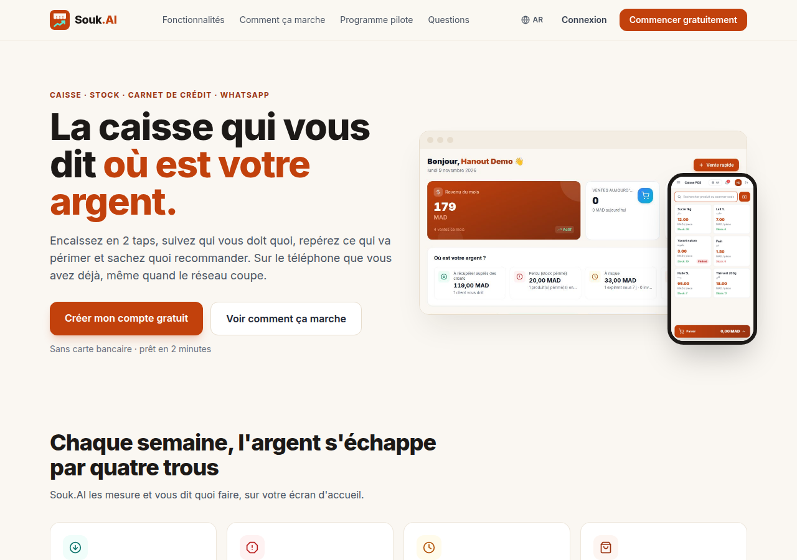
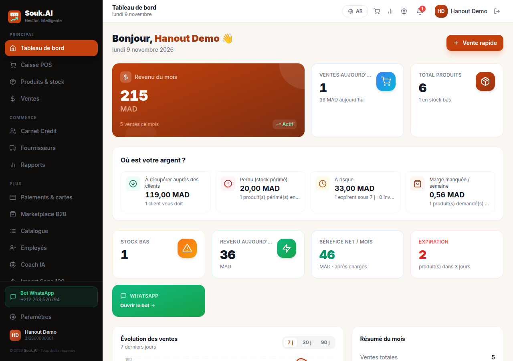
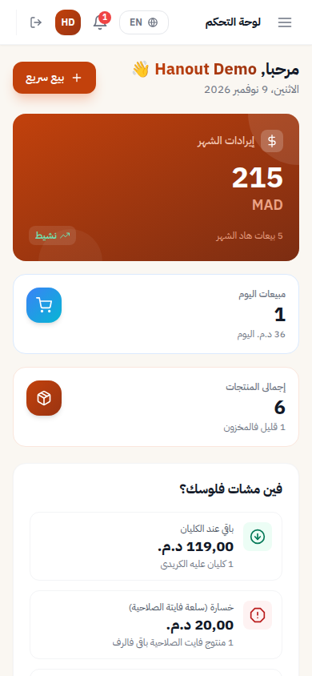
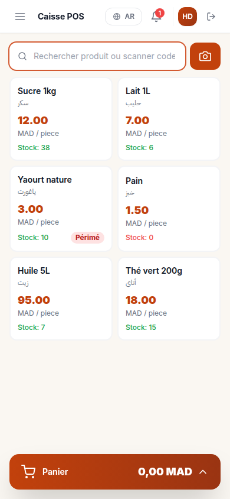

<p align="center">
  
</p>

<h1 align="center">Souk.AI</h1>
<p align="center"><strong>La caisse intelligente du petit commerce — POS, stock, carnet de crédit, prévisions IA, WhatsApp.</strong><br/>
<em>The smart till for small shops — POS, stock, customer tabs, AI forecasts, WhatsApp.</em></p>

<p align="center"><a href="#francais">Français</a> · <a href="#english">English</a></p>

| Accueil | Tableau de bord | Arabe (RTL), mobile | Caisse mobile |
|---|---|---|---|
|  |  |  |  |

---

<a id="francais"></a>
## Français

### Le problème
Les épiceries, supérettes et petits restaurants gèrent stock et crédit client sur papier. L'argent se perd en
produits périmés, en ruptures sur les meilleures ventes et en créances oubliées dans le « carnet ».

### Ce que fait Souk.AI
| Domaine | Fonctionnalités |
|---|---|
| **Caisse (POS)** | Vente en 2 taps, scan code-barres (caméra/douchette), espèces / crédit client / carte, ticket avec TVA incluse. Encaissement **atomique et idempotent** ; ventes en espèces **hors ligne** synchronisées au retour du réseau ; historique des ventes avec **retours**. |
| **Où est votre argent ?** | Argent à récupérer (carnet), perdu (périmés), à risque (expire sous 7 j, invendus 30 j), marge manquée par rupture — chaque ligne mène à l'action. |
| **Stock & produits** | Stock temps réel avec journal de chaque mouvement, seuils, dates d'expiration, **TVA par produit**, scan de facture fournisseur (GPT-4o Vision), import Sage 100. |
| **Rapports** | Ventes et marges nettes des retours au coût réel, dans le fuseau du commerçant ; réassort prévu à 7 jours (modèle backtesté : WAPE 0,205 vs 0,266 pour la moyenne naïve) ; **TVA collectée par taux** pour la déclaration. |
| **Carnet de crédit** | Plafond par client, remboursements, reçu WhatsApp, rappels hebdomadaires **avec l'accord du client**. |
| **WhatsApp IA** | Darija / FR / EN : « sardines 10 DH », rapport du jour, alertes, réinitialisation par OTP. |
| **Fournisseurs & B2B** | Commandes fournisseurs ; une livraison reçue **remet le stock à jour au coût moyen pondéré** ; portail fournisseur ; marketplace entre commerçants. |
| **Langues & pays** | FR / AR (RTL) / EN ; devise, fuseau et formats par marchand ; profils pays (MA, DZ, TN, SN, CI, FR, BE, ES, DE, IT, NL, GB, US, CA). |
| **Confiance** | Export de toutes ses données (JSON), suppression de compte, rôles marchand / fournisseur / admin. |

### Démarrage rapide
```bash
cp .env.example .env          # puis remplir SECRET_KEY (openssl rand -hex 32) et, si besoin, les clés API
make up                       # docker compose + migrations
make seed                     # données de démo : 0600000000 / demo-souk-2026
# Front : http://localhost  ·  API : http://localhost:8000/docs (hors production)
```
Sans clé OpenAI ni WhatsApp, l'application fonctionne ; seules les fonctions IA/WhatsApp sont désactivées.

### Tests & qualité
```bash
make test-up && make test     # 66 tests d'intégration sur Postgres migré par Alembic + Redis
cd frontend && npm run dev &  # puis, backend lancé :
npm run e2e                   # Playwright : inscription → tableau de bord, vente cash en 2 taps
make lint && make audit       # ruff, pip-audit, npm audit
```
La CI GitHub Actions (`.github/workflows/ci.yml`) exécute lint, tests, aller-retour de migration, audits de
dépendances, bandit, build front et e2e.

### Sécurité (résumé)
Rôle admin stocké en base (jamais déduit de l'email), OTP et PIN carte protégés contre la force brute,
limitation de débit, révocation des sessions au changement de mot de passe, webhooks signés obligatoires en
production, en-têtes HTTP de sécurité, uploads bornés. Détails : [`docs/audit/AUDIT.md`](docs/audit/AUDIT.md).
Signaler une vulnérabilité : contactez l'équipe en privé (pas d'issue publique).

### Déploiement
Ne mettez jamais d'identifiants dans le dépôt. `deploy.py` lit `DEPLOY_HOST`, `DEPLOY_USER` et utilise votre
clé SSH. En production : `APP_ENV=production`, un `SECRET_KEY` aléatoire, `WHATSAPP_APP_SECRET` et
`CMI_STORE_KEY` renseignés (sinon les webhooks sont refusés), puis `alembic upgrade head` avec `ADMIN_PHONE`
défini pour désigner l'admin (ou `python -m scripts.grant_admin <téléphone>`).

### Documentation
- Audit, stratégie, décisions, rapport : [`docs/audit/`](docs/audit/)
- Identité de marque (logo, couleurs, typo, ton) : [`docs/BRAND.md`](docs/BRAND.md)
- WhatsApp : [`docs/WHATSAPP_SETUP.md`](docs/WHATSAPP_SETUP.md)

---

<a id="english"></a>
## English

### The problem
Grocery stores, convenience stores and small restaurants run stock and customer credit on paper. Money leaks
through expired goods, stock-outs on best sellers and forgotten tabs.

### What Souk.AI does
| Area | Features |
|---|---|
| **Point of sale** | 2-tap sale, barcode scan, cash / customer tab / Souk.AI NFC card, receipts, returns. **Atomic, idempotent** checkout; **offline cash sales** sync when the network is back. |
| **Where is your money?** | Money to collect (tabs), lost (expired), at risk (expiring in 7 days, unsold for 30 days), margin missed on stock-outs, each linked to the fix. |
| **Stock & products** | Real-time stock, thresholds, expiry dates, bilingual catalog, supplier-invoice scan (GPT-4o Vision), Sage 100 import. |
| **Forecasts** | 7-day demand per product and restock suggestions; backtested model (WAPE 0.205 vs 0.266 for a naive mean). |
| **Customer tabs** | Per-customer limit, repayments, WhatsApp receipt, reminders. |
| **AI on WhatsApp** | Darija / French / English commands, daily report, alerts, OTP password reset. |
| **Suppliers & B2B** | Supplier orders, supplier portal, merchant-to-merchant marketplace. |
| **Languages & countries** | FR / AR (RTL) / EN; per-merchant currency, timezone and formats; country profiles for North Africa, West Africa, the EU, the UK, the US and Canada. |
| **Trust** | Full data export (JSON), account deletion, merchant / supplier / admin roles. |

### Quick start
```bash
cp .env.example .env          # set SECRET_KEY (openssl rand -hex 32) and optional API keys
make up                       # docker compose + migrations
make seed                     # demo data: 0600000000 / demo-souk-2026
# Web: http://localhost  ·  API docs: http://localhost:8000/docs (non-production only)
```

### Tests
`make test-up && make test` (integration tests on real Postgres + Redis), `npm run e2e` (Playwright),
`make lint`, `make audit`. CI runs all of them.

### Stack
FastAPI · SQLAlchemy 2 (async) · PostgreSQL/TimescaleDB · Redis · Celery · Weaviate · React 18 · Vite ·
Tailwind · Nginx · Docker Compose.

### Project layout
```
backend/   api/v1 (routes) · services (business logic) · models · schemas · core (auth, money, locale,
           rate limit) · workers (Celery) · alembic · tests
frontend/  src/pages · src/components · src/utils (money, offline queue) · src/i18n (fr, ar, en) · e2e
docs/      audit/ (AUDIT, STRATEGY, DECISIONS, REPORT…) · screenshots/
```
